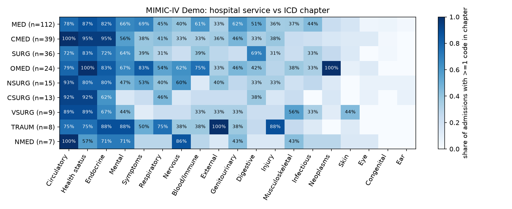
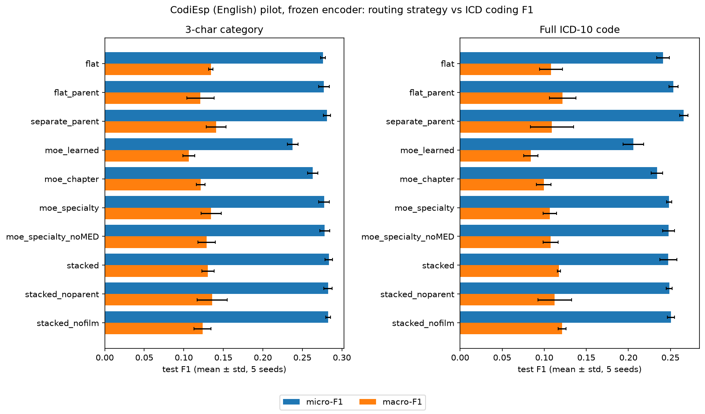

# Pilot: chapter-routed vs specialty-routed Mixture-of-Experts for ICD coding

This pilot runs on open data while MIMIC-IV access is pending. It tests the routing ideas from the
10/13 meeting goals. All numbers below come from `out/` and were produced on a laptop (M1 Pro) with a
frozen Bio_ClinicalBERT encoder. They are a small-data pilot that shows the pipeline works and how the
variants compare; they are not final conclusions.

## Data

| Dataset | Size | Used for |
|---|---|---|
| MIMIC-IV Demo v2.2 (PhysioNet, open) | 275 admissions, no notes | Experiment 1: hospital service vs ICD chapter |
| MTSamples (Hugging Face mirror) | 2,094 unique notes after dedup, 11 service groups | Specialty classifier (the "router") |
| CodiEsp, English (CLEF eHealth 2020, CC BY 4.0) | 500 / 250 / 250 clinical case reports, ICD-10 | Experiment 2: ICD coding with different routing |

Codes seen fewer than 3 times in train are dropped, which leaves 393 three-character categories and
476 full codes.

## Experiment 1: does hospital service tell you the ICD chapter? (MIMIC-IV Demo)



- **40.7% of admissions start under general medicine (MED).** The concern about a large general-medicine
  group holds even in the demo.
- An admission spans **7.7 ICD chapters on average**. Every service's patients carry circulatory,
  endocrine and Z-codes. Chapter labels are therefore heavily multi-label, while service is one label per
  admission.
- The first service explains **~29% of the uncertainty** in the primary diagnosis's chapter (mutual
  information / entropy). With n=275 this estimate is biased upward. Service is informative
  for cardiac medicine and cardiac surgery (85% of primary diagnoses fall in one chapter) and much less
  for MED (16%) and oncology (17%).

## Specialty router

A TF-IDF + logistic regression classifier trained on MTSamples reaches **84% held-out accuracy
(macro-F1 0.85)** over 11 service groups. A first version scored 42%. The cause was that MTSamples files
the same note under several specialties, mostly "X" plus "Surgery", which leaked conflicting labels across
the split. The fix keeps one copy per note and prefers the specific specialty.

The router then gives each CodiEsp note a soft specialty distribution (a stand-in for MIMIC's
`services` table, which is known at prediction time).

## Experiment 2: routing strategy vs ICD coding F1 (CodiEsp, 5 seeds)



| variant | category micro-F1 | full-code micro-F1 | full-code macro-F1 | gate entropy |
|---|---|---|---|---|
| flat (no experts) | 0.276 ± 0.003 | 0.241 ± 0.007 | 0.108 ± 0.014 | |
| flat + parent conditioning (one model) | 0.277 ± 0.007 | 0.254 ± 0.005 | **0.122 ± 0.016** | |
| two separate models (parent, then full code) | 0.281 ± 0.004 | **0.266 ± 0.005** | 0.109 ± 0.026 | |
| MoE, learned gate | 0.238 ± 0.007 | 0.206 ± 0.012 | 0.084 ± 0.009 | 0.25 |
| MoE, chapter-routed | 0.263 ± 0.007 | 0.234 ± 0.007 | 0.099 ± 0.009 | 0.69 |
| MoE, specialty-routed | 0.277 ± 0.007 | 0.248 ± 0.003 | 0.107 ± 0.008 | 0.89 |
| MoE, specialty-routed, no MED expert | 0.278 ± 0.006 | 0.248 ± 0.007 | 0.108 ± 0.009 | 0.88 |
| Stacked (specialty → chapter → FiLM + parent) | **0.283 ± 0.005** | 0.248 ± 0.010 | 0.118 ± 0.002 | 0.55 |
| Stacked, no parent conditioning | 0.282 ± 0.005 | 0.249 ± 0.004 | 0.112 ± 0.020 | 0.54 |
| Stacked, no FiLM | 0.282 ± 0.003 | 0.251 ± 0.004 | 0.121 ± 0.005 | 0.56 |

Full table with macro-F1 for categories, parameter counts and expert usage: `out/moe_results.md`.

**What the pilot suggests**

1. **Specialty routing beat chapter routing** by ~1.4 F1 points at both code levels (about 3 standard
   errors over seeds), even though the chapter MoE has twice the parameters. A likely reason: a note
   spans many chapters, so the chapter gate has to be predicted from text and spreads its weight. The
   specialty gate is given as an input.
2. **No MoE clearly beat the flat baseline.** The specialty-routed MoE matched it. With 500 training
   notes, experts get little data each. The learned (unsupervised) gate collapsed onto ~1.5 experts and
   was worst, which supports using supervised routing (chapter or specialty labels) over a free gate.
3. **Parent → child conditioning helped full codes** (+1.2 micro-F1, +1.4 macro-F1 over flat). Published
   hierarchy methods on MIMIC-III report gains of about the same size (+0.9 to +1.2 micro-F1).
   **Two separate models** (a category model, then a full-code model that rereads the note and takes the
   first model's category scores) gave the best full-code micro-F1 (0.266, +1.2 over one model). But the
   pair has twice the parameters, and its full-code macro-F1 was lower and noisy (0.109 ± 0.026), so the
   gain may be mostly on common codes.
4. **Stacked specialty → chapter** gave the best category micro-F1, but the margin over flat is within
   ~1–2 standard deviations. **FiLM conditioning on specialty and chapter did not help.** Removing it
   was as good or better.
5. **Dropping the general-medicine expert changed nothing here**, because the router labels only ~8% of
   CodiEsp notes as MED. On MIMIC (41% MED) this ablation should matter much more.

**Caveats**

- Frozen encoder and 500 training notes, so absolute F1 is low. The comparison between variants is
  the point, not the absolute numbers.
- Error bars cover seed variance only, not test-set sampling (250 notes).
- The specialty labels are predicted from MTSamples, which differs from CodiEsp (case reports from
  journals). Specialty gates are soft (entropy 0.89), so the specialty MoE partly acts like an ensemble.
  MIMIC's real `services` labels would give much sharper routing.
- Codes seen fewer than 3 times are excluded; rare-code behavior needs MIMIC.

## Files

| File | What it does |
|---|---|
| `common.py` | ICD-9/10 → chapter mapping (with self-check), MTSamples → service map |
| `mimic_demo.py` | Experiment 1 |
| `prepare.py` | Specialty router, frozen embeddings, label matrices → `out/codiesp_features.npz` |
| `run_moe.py` | Experiment 2, all 10 variants (frozen encoder; ~10 min on a laptop CPU) |
| `finetune.py` | Same variants with Bio_ClinicalBERT fine-tuned end to end (GPU) |
| `kaggle_pilot.ipynb` | Self-contained notebook: downloads data, runs everything on a free Kaggle GPU |

Run locally from `pilot/`:

```bash
../.venv/bin/python mimic_demo.py && ../.venv/bin/python prepare.py && ../.venv/bin/python run_moe.py
```
